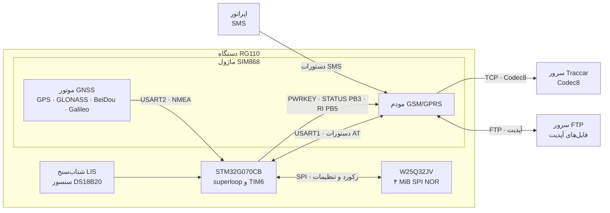
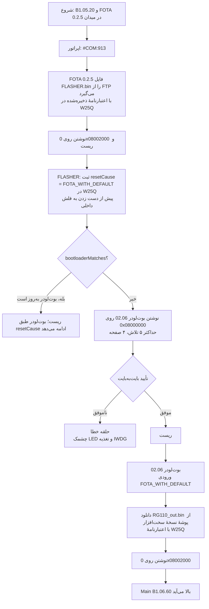
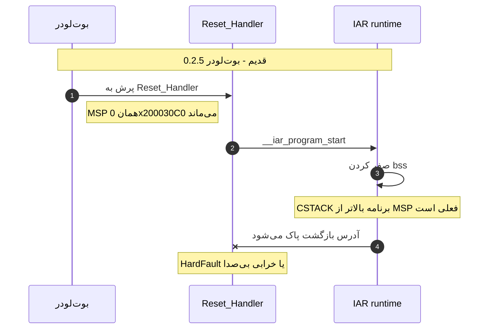
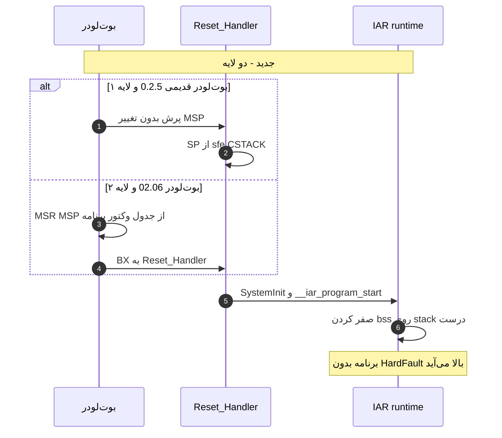
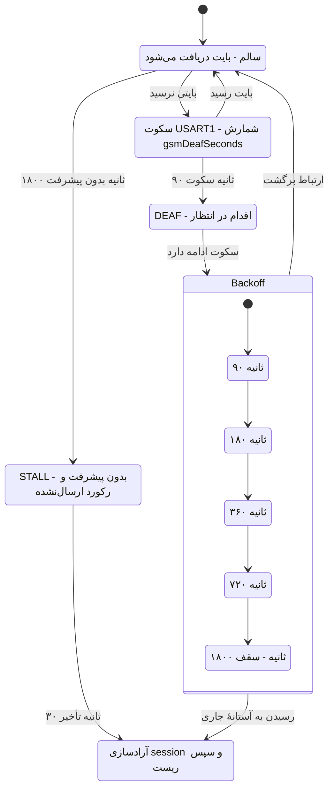
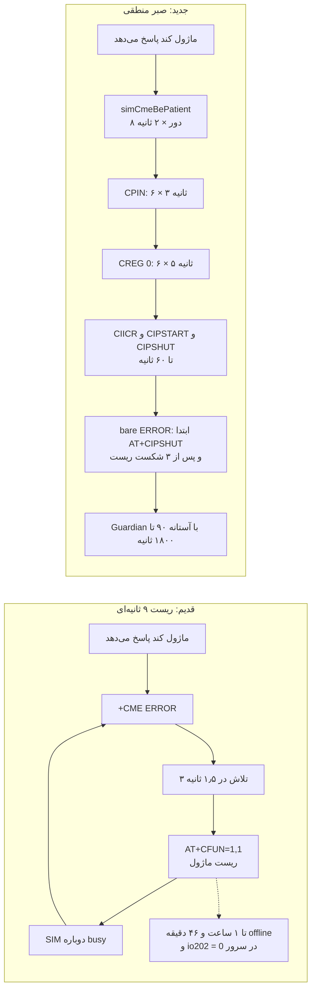
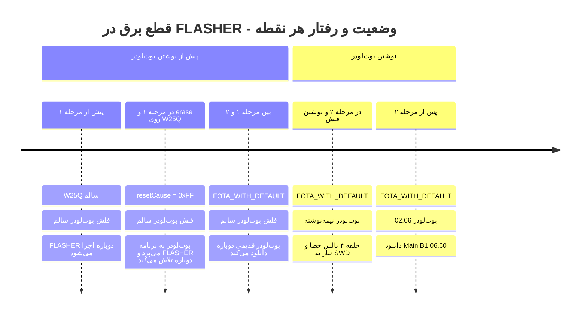
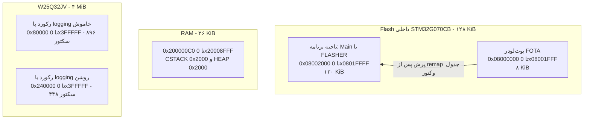
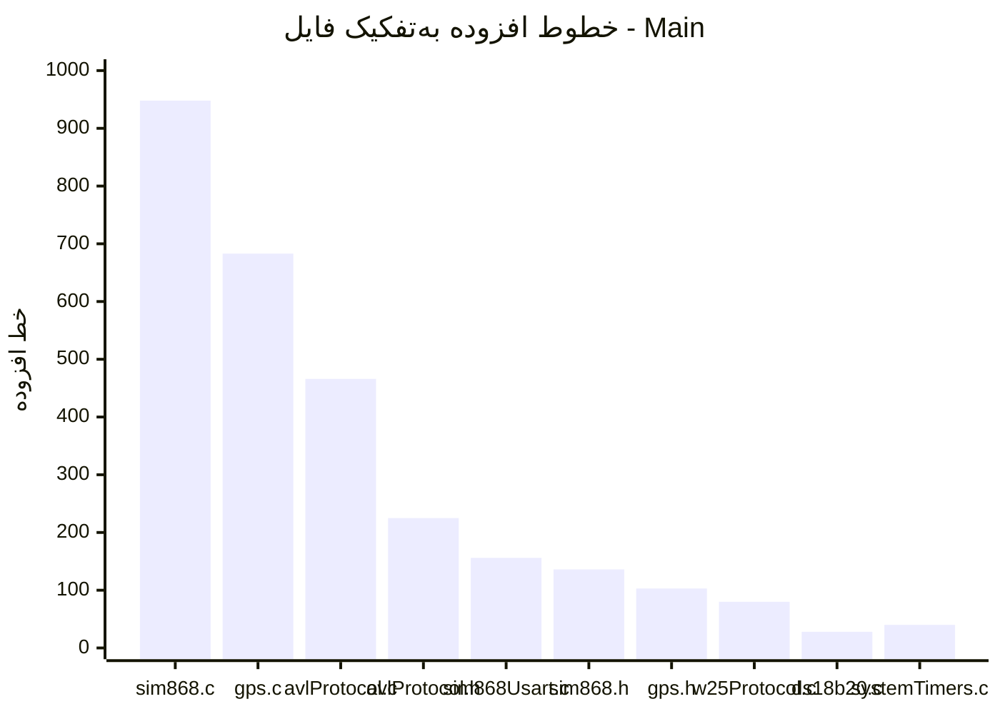

<!--
نکتهٔ نمایش (bidi): کل گزارش داخل یک بلوک rtl قرار دارد تا جدول‌ها و فهرست‌ها راست‌به‌چپ بمانند.
بلوک‌های کد و Mermaid چپ‌به‌راست‌اند و توضیح کدها انگلیسی نوشته شده است.
برای نمایش درست، فایل را در GitHub، GitLab یا Obsidian باز کنید.
-->
<div dir="rtl" lang="fa">

# گزارش کار توسعه فریمویر دستگاه RG110

| | |
|---|---|
| **تاریخ گزارش** | ۱۴۰۵/۰۷/۲۴ (۲۰۲۶-۱۰-۱۶) |
| **پروژه** | RG110، ردیاب GPS خودرو |
| **مجری** | آتی فرزام ایرانیان |
| **کارفرما** | ره نگار گستر |
| **تهیه‌کننده** | محمدجواد یوسفی‌پور |
| **نسخه‌های تحویلی** | Main `B1.06.60`، FOTA `02.06`، `FLASHER_913_02.06` |
| **پلتفرم** | `STM32G070CB` (هسته Cortex-M0+، ۱۲۸ کیلوبایت Flash، ۳۶ کیلوبایت RAM) |
| **ابزار کامپایل** | IAR EWARM، نتیجه build: ۰ خطا و ۲۳۸ هشدار (پیوست ت) |

**فهرست مطالب**

1. خلاصه اجرایی
2. معماری و نسخه‌ها
3. وضعیت تست و تأیید
4. روش آپدیت
5. برنامه بازگشت (Rollback)
6. ریسک‌ها و محدودیت‌های باقی‌مانده
7. گام‌های پیشنهادی بعدی
8. رجیستر تغییرات
9. شرح فنی تغییرات (`RG-01` تا `RG-22`)
10. پیوست الف: نقشه حافظه
11. پیوست ب: دستورات جدید SMS
12. پیوست پ: آمار تغییرات
13. پیوست ت: وضعیت هشدارهای build

**راهنمای مطالعه.** مدیر و تصمیم‌گیر: بخش‌های ۱، ۴، ۶ و ۸. مهندس بعدی: بخش‌های ۳ تا ۹ و پیوست‌ها. هر تغییر مهم در بخش ۹ با زنجیرهٔ «علامت در میدان ← علت ریشه‌ای ← اصلاح ← اثر ← پشتوانه» نوشته شده است.

---

## ۱. خلاصه اجرایی

دستگاه RG110 یک ردیاب GPS صنعتی است. ماژول `SIM868` ارتباط سلولی (GSM/GPRS) و ماهواره‌ای (GPS، GLONASS، BeiDou و Galileo) را فراهم می‌کند و حافظهٔ `W25Q32JV` (۴ مگابایت، SPI NOR) تله‌متری را نگه می‌دارد. فریمویر بدون HAL و بدون RTOS، روی یک superloop ۸۸ مرحله‌ای و وقفهٔ تایمر `TIM6` با نرخ ۱ هرتز اجرا می‌شود.

آتی فرزام ایرانیان حدود دو ماه پیش توسعهٔ فریمویر RG110 را در وضعیت بحرانی در اختیار گرفت: پس از آپدیت OTA از کار می‌افتاد، ساعت‌ها offline می‌ماند و تنظیمات مشتری را از دست می‌داد. فریمویر دریافتی (Main `B1.05.xx` و FOTA `0.2.5`) بررسی، اصلاح و گسترش یافت و سه جزء تحویل داده می‌شود: Main `B1.06.60`، بوت‌لودر FOTA `02.06` و ابزار `FLASHER_913_02.06`. اکنون دستگاه در وضعیت کنترل‌شده است، از راه دور آپدیت می‌شود و با Black Box تشخیصی قابل عیب‌یابی است.

### نمای کلی: تحویل‌گرفته‌شده در برابر تحویل‌داده‌شده

| حوزه | تحویل‌گرفته‌شده | تحویل‌داده‌شده | اثر برای ناوگان |
|---|---|---|---|
| آپدیت OTA | `MSP` اشتباه پس از پرش بوت‌لودر؛ دستگاه متوقف می‌شد و فقط برنامه‌ریزی مجدد با SWD آن را برمی‌گرداند | `MSP` در هر دو سمت (بوت‌لودر و Main) تنظیم می‌شود (`RG-01`) | آپدیت OTA به این علت دیگر به مراجعه حضوری با SWD ختم نمی‌شود (به‌جز خطای قطع برق هنگام نوشتن بوت‌لودر، بخش ۶) |
| ارتباط سلولی | بافر `USART1` قفل‌شونده، ریست ۹ ثانیه‌ای ماژول، قطعی تا ۱ ساعت و ۴۶ دقیقه | بافر دایره‌ای، ریکاوری سخت‌افزاری USART، Guardian با back-off و timeoutهای مطابق `SIM868` (`RG-02`، `RG-03`، `RG-11`) | علت‌های شناخته‌شدهٔ قطعی چندساعته برطرف شد |
| ارسال و ثبت داده | سرریز بافر Codec8، رانش `serverDataNotSendCount`، آدرس‌دهی اشتباه W25Q | clamp و guard، decrement با guard، آدرس‌دهی runtime (`RG-04`، `RG-09`، `RG-10`) | ریست حین ارسال صف، حالت «آنلاین ولی ساکت» و رکورد تکراری یا گم‌شده حذف شد |
| پیکربندی مشتری | پاک شدن بی‌صدای تنظیمات پس از آپدیت؛ خرابی marker حالت اتصال | `TC_NOP`، commit پیش از اجرا، stamping متادیتا، self-heal (`RG-05`، `RG-06`) | تنظیمات سرور، APN و رمز SMS پس از آپدیت از بین نمی‌رود |
| آپدیت بوت‌لودر | بوت‌لودر فقط با SWD قابل تغییر بود | `FLASHER_913_02.06` از راه دور و با دستور موجود `#COM:913` (`RG-18`) | اصلاح بوت‌لودر ناوگان بدون کابل |
| امنیت | شمارهٔ مجاز ثابت در کد، یکسان برای همهٔ دستگاه‌ها | فهرست خالی به‌عنوان پیش‌فرض (`RG-17`) | هر دستگاه فقط با شماره‌های خودش کنترل می‌شود |
| تشخیص | بایت تشخیصی در هر ۱٬۰۵۸ رکورد لاگ مرجع صفر بود؛ `io202 = 0` گمراه‌کننده بود | Black Box با ۱۰ فیلد و `#GET:194` (`RG-19`، `RG-20`) | با فعال‌سازی `#SET:231,1`، علت قطعی از روی داده سرور قابل خواندن است |

> [!IMPORTANT]
> **تغییر ناسازگار:** فهرست شماره‌های مجاز در نسخه جدید به‌صورت پیش‌فرض خالی است. شماره‌های هر دستگاه را پیش از آپدیت یادداشت کنید و پس از آن با SMS دوباره ثبت کنید (`RG-17`).

**وضعیت تست:** همه تغییرات روی دستگاه واقعی تست شده‌اند. جزئیات و تاریخ‌ها در بخش ۳ آمده است.

**ریسک باقی‌ماندهٔ اصلی:** قطع برق هنگام نوشتن بوت‌لودر توسط `FLASHER` است که بازگردانی آن فقط با `SWD` ممکن است (بخش ۶).

---

## ۲. معماری و نسخه‌ها

### ۲-۱. معماری سیستم



### ۲-۲. نسخه‌ها: مبدا و مقصد

| جزء | نسخه مبدا | نسخه مقصد | حجم تغییرات |
|---|---|---|---|
| برنامه اصلی (Main) | `B1.05.xx` | **`B1.06.60`** | ۲۳ فایل متنی، `+2,969 / −368` خط |
| بوت‌لودر FOTA | `0.2.5` | **`02.06`** | ۵ فایل، `+47 / −16` خط |
| FLASHER | وجود نداشت | **`FLASHER_913_02.06`** | جزء جدید (بدون baseline) |

**نسخه شروع در میدان:** `B1.05.20` همراه با FOTA `0.2.5`.

### ۲-۳. فایل‌های تحویلی

| فایل | توضیح | اندازه |
|---|---|---|
| `RG_FOTA.bin` | بوت‌لودر `02.06` | ۷٬۴۷۵ بایت |
| `FLASHER.bin` | ابزار به‌روزرسانی بوت‌لودر | ۱۰٬۱۹۰ بایت |
| `RG110_out.bin` | Main `B1.06.60`، روی FTP و در مسیر نسخه سخت‌افزار | — |

---

## ۳. وضعیت تست و تأیید

همه تغییرات این گزارش روی دستگاه واقعی تست شده‌اند.

### ۳-۱. شواهد میدانی در تشخیص مشکل‌ها

- **لاگ مرجع میدانی (۱٬۰۵۸ رکورد):** یافته: بایت تشخیصیِ سابق (`ggaRejects<<4 | rmcFails`) در هر ۱٬۰۵۸ رکورد صفر بود؛ اقدام: آن بایت به شمارندهٔ ریکاوری USART (`io211`) تغییر کاربری داد (`avlProtocol.h:744-752`).
- **همان لاگ:** یافته: یک قطعی ۷ ساعته با ۴۹ رکورد «ظاهراً سالم» نشان داد که پرچم‌های GPS در آن منجمد بود؛ اقدام: پاک‌سازی پرچم‌ها به `creatBasePacketData()` منتقل شد (`avlProtocol.c:655-661`).
- **شاهد میدانی USART:** بیش از ۲۱ بار power-cycle بی‌نتیجه، در حالی که `io204` در حال چرخش و `io202` برابر صفر بود. یعنی TX و state machine زنده بودند و RX مرده بود.
- **تست مستندشده با تاریخ:** دستور SMS `194` در ۱۴۰۵/۰۷/۰۶ (۲۰۲۶-۰۹-۲۸) روی دستگاه واقعی تأیید شد.

### ۳-۲. ماتریس آزمون

| شناسه | حوزه | هدف یا سناریوی آزمون | تاریخ/مرجع |
|---|---|---|---|
| `RG-01` | بوت‌لودر | بالا آمدن Main پس از پرش بوت‌لودر قدیم و جدید |  |
| `RG-02` | SIM868 | تزریق خطای USART با خاموش/روشن کردن ماژول در حین انتقال |  |
| `RG-03` | SIM868 | همان سناریوی تزریق خطا؛ رفتار Guardian و `io211` |  |
| `RG-04` | سرور | ارسال صف کامل Codec8 به Traccar و تطابق Number of Data با تعداد رکوردها |  |
| `RG-05` | سرور | دستگاه با `server_url[0]=='a'` (self-heal) و دستگاه در حالت IP |  |
| `RG-06` | پیکربندی | قطع برق تصادفی ۲۰ بار هنگام ارسال به سرور؛ سلامت رینگ W25Q |  |
| `RG-07` | بوت‌لودر | مسیرهای recovery با FTP اختصاصی ذخیره‌شده در W25Q |  |
| `RG-08` | SIM868 | آزاد شدن session پیش از ریست FOTA |  |
| `RG-09` | SIM868 | تخلیه صف و رسیدن `serverDataNotSendCount` به صفر |  |
| `RG-10` | حافظه W25Q | علامت‌گذاری sent روی رکورد درست با logging روشن |  |
| `RG-11` | SIM868 | `+CME ERROR`، `+CREG: 0`، `bare ERROR` و توالی `PWRKEY` |  |
| `RG-12` | GPS | رد GGA بدون فیکس و رد جملات `$GLGSA` |  |
| `RG-13` | GPS | bearing با gate فاصله |  |
| `RG-14` | GPS | خواب کوتاه کمتر از ۱۸۰ ثانیه |  |
| `RG-15` | رویدادها | قطع برق اصلی همراه با لرزش |  |
| `RG-16` | سخت‌افزار | خواندن دما روی `PB2` با برد جدید |  |
| `RG-17` | امنیت | فهرست خالی پس از reset تنظیمات |  |
| `RG-18` | FLASHER | توالی `#COM:913` تا بالا آمدن Main `B1.06.60` |  |
| `RG-19` | سرور | ارسال فیلدهای تشخیصی با `#SET:231,1` |  |
| `RG-20` | SMS و GPS | پاسخ `#GET:194` | ۱۴۰۵/۰۷/۰۶ (۲۰۲۶-۰۹-۲۸) |
| `RG-21` | GPS | ریست GPS پس از نبود فیکس |  |
| `RG-22` | خواب و صف | تخلیه صف پیش از ورود به خواب |  |

---

## ۴. روش آپدیت

ترتیب اجباری است و خودکار انجام می‌شود. اپراتور فقط دستور موجود `#COM:913` را ارسال می‌کند. FLASHER جزء جدید است و دستور تازه‌ای برای آن تعریف نشده است.



**مراحل**

1. **نقطه شروع:** دستگاه با `B1.05.20` و FOTA `0.2.5` در میدان است.
2. **`#COM:913`:** بوت‌لودر `0.2.5` فایل `FLASHER.bin` را از FTP دانلود می‌کند، روی اسلات برنامه (`0x08002000`) می‌نویسد و ریست می‌کند.
3. **اجرای FLASHER:** ابتدا `resetCause = FOTA_WITH_DEFAULT` را در W25Q ثبت می‌کند، پیش از دست زدن به فلش داخلی. سپس بوت‌لودر `02.06` را روی `0x08000000` می‌نویسد، با `bootloaderMatches()` بایت‌به‌بایت تأیید می‌کند و ریست می‌کند (`FLASHER main.c:64-111`).
4. **بوت‌لودر `02.06`:** به‌خاطر `FOTA_WITH_DEFAULT`، فایل `<hardwareVersion>/RG110_out.bin` را از FTP (با اعتبارنامهٔ W25Q) می‌گیرد و روی `0x08002000` می‌نویسد. نتیجه: Main `B1.06.60` بالا می‌آید.

**نکته‌ها**

- FOTA `02.06` را FLASHER می‌نویسد، نه خود FOTA. بوت‌لودر فقط ناحیهٔ برنامه (`0x08002000` به بعد) را برنامه‌ریزی می‌کند (`FLASH.h:11-14`).
- در اجرای مجدد، بوت‌لودر دوباره نوشته نمی‌شود (`bootloaderMatches()` درست برمی‌گرداند). اما `resetCause = FOTA_WITH_DEFAULT` پیش از این چک ثبت می‌شود، پس ریست بعدی می‌تواند دانلود دوبارهٔ Main از FTP را فعال کند. این رفتار تأیید می‌شود.
- شماره‌های مجاز هر دستگاه را پیش از آپدیت یادداشت کنید (`RG-17`).

---

## ۵. برنامه بازگشت (Rollback)

| جزء | راه بازگشت | محدودیت |
|---|---|---|
| Main `B1.06.60` به `B1.05.20` | از مسیر خود FOTA: فایل قدیمی به‌عنوان `RG110_out.bin` روی FTP (پوشهٔ نسخهٔ سخت‌افزار) گذاشته می‌شود و فرمان دانلود صادر می‌شود، همان مسیری که برنامهٔ جدید آمد. | رینگ W25Q دست‌نخورده می‌ماند و تاریخچهٔ تله‌متری حفظ می‌شود (اندازهٔ رکورد ۶۴ بایت ثابت است، `avlProtocol.h:763-768`). تنظیمات تغییرکرده، مثل شماره‌های مجاز، خودکار برنمی‌گردند. |
| FOTA `02.06` به `0.2.5` | از داخل خود دستگاه ممکن نیست، چون FOTA ناحیهٔ بوت‌لودر را نمی‌نویسد. به FLASHER برگشتی با همان معماری یا SWD نیاز دارد. | در صورت نیاز باید FLASHER برگشتی ساخته شود. |
| `FLASHER_913_02.06` | موقتی است: بعد از اجرا خاموش می‌شود و چیزی برای بازگشت ندارد. | اجرای مجدد روی دستگاه به‌روز بی‌اثر است. |

بازگشت به `B1.05.20` با نشانگر مهاجرت جدید (`0xFFFC`) ممکن است مهاجرت مخرب نسخهٔ قدیمی را دوباره فعال کند (مرتبط با `RG-06`). پیش از `rollback` روی ناوگان باید روی یک دستگاه آزمایشی تأیید شود.

هیچ‌کدام از مسیرهای بازگشت ناحیهٔ W25Q (تنظیمات و رینگ رکورد) را پاک نمی‌کنند. پاک‌سازی کامل فقط با `TC_ERASE_RECORDS` انجام می‌شود.

---

## ۶. ریسک‌ها و محدودیت‌های باقی‌مانده

| شدت | ریسک | اثر در میدان |
|---|---|---|
| 🔴 بحرانی | قطع برق هنگام نوشتن بوت‌لودر توسط `FLASHER` | فقط `SWD` |
| — | ثبت `resetCause = FOTA_WITH_DEFAULT` پیش از چک `bootloaderMatches()` در اجرای مجدد `#COM:913` | ریست بعدی می‌تواند دانلود دوبارهٔ Main از FTP را فعال کند |
| — | بازگشت به `B1.05.20` با نشانگر مهاجرت جدید (`0xFFFC`) | ممکن است مهاجرت مخرب نسخهٔ قدیمی را دوباره فعال کند (مرتبط با `RG-06`) |
| — | self-heal در `server_url[0]` | دستگاه به URL پیش‌فرض کارخانه وصل می‌شود و تا تنظیم مجدد با SMS ۱۱۰ تا ۱۱۲، داده‌ی آن دستگاه ممکن است به سرور پیش‌فرض برسد |
| — | مکانیزم صحت‌سنجی (CRC یا امضا) فایل‌های `FLASHER` و `Main` پیش از نوشتن | در این گزارش مستند نشده است |

*ارزیابی شدت در دست تکمیل است.*

---

## ۷. گام‌های پیشنهادی بعدی

- رفع off-by-one در `w25Protocol.c:1200`.
- پیاده‌سازی پچ پیشنهادی (پیاده‌نشده) بخش `RG-05`.
- ذخیرهٔ لاگ کامل build در پوشهٔ `build/` و رده‌بندی هشدارهای truncation، uninitialized و pointer cast.
- افزودن `volatile` در FOTA.
- `uint32_t` شدن `gsmTimeoutCounter` برای پوشش کامل ۸۵ ثانیه.
- تأیید `rollback` روی یک دستگاه آزمایشی پیش از اجرا روی ناوگان.
- تعریف مکانیزم صحت‌سنجی (CRC یا امضا) برای فایل‌های `FLASHER` و `Main` پیش از نوشتن.

---

## ۸. رجیستر تغییرات

**مقیاس شدت**

شدت بر پایهٔ پیامد مشکلِ رفع‌شده یا ریسک باقی‌مانده سنجیده شده است.

- 🔴 *بحرانی*: دستگاه فقط با SWD برمی‌گردد.
- 🟠 *بالا*: از دست رفتن ارتباط، داده یا تنظیمات.
- 🟡 *متوسط*: خرابی محدود یا پیکربندی بی‌اثر.
- 🟢 *پایین*: اثر ناچیز.
- ⚪ *—*: ارزیابی شدت در دست تکمیل است.

| شناسه | عنوان | شدت | فایل‌های اصلی |
|---|---|---|---|
| `RG-01` | مقدار اشتباه `MSP` پس از پرش بوت‌لودر | 🔴 بحرانی | `boot.c`، `startup_stm32g070xx.s` |
| `RG-02` | بافر دریافت USART1 اشباع‌شونده و ریکاوری سخت‌افزاری | 🟠 بالا | `sim868Usart.c` |
| `RG-03` | Guardian (DEAF و STALL) و حلقه ریست ماژول | 🟠 بالا | `sim868.c`، `systemTimers.c` |
| `RG-04` | سرریز بافر Codec8 و خرابی RAM | 🟠 بالا | `avlProtocol.h/.c` |
| `RG-05` | خرابی mode marker در `server_url[0]` | 🟠 بالا | `w25Protocol.c` |
| `RG-06` | پاک شدن بی‌صدای تنظیمات پس از آپدیت | 🟠 بالا | `avlProtocol.c`، `w25Protocol.c` |
| `RG-07` | اعتبارنامه FTP در مسیرهای recovery بوت‌لودر | 🔴 بحرانی | `GSM.c`، `consts.c` (FOTA) |
| `RG-08` | آزاد نشدن session GPRS پیش از ریست FOTA | 🟠 بالا | `sim868.c` |
| `RG-09` | رانش `serverDataNotSendCount` | 🟠 بالا | `sim868.c` |
| `RG-10` | آدرس‌دهی اشتباه رکورد W25Q | 🟠 بالا | `w25Protocol.c` |
| `RG-11` | بازنویسی منطق tolerance پروتکل GSM | 🟠 بالا | `sim868.c/.h` |
| `RG-12` | GPS: انجماد timestamp و جملات GLONASS | 🟡 متوسط | `gps.c` |
| `RG-13` | GPS: bearing بر پایه فاصله | 🟢 پایین | `gps.c` |
| `RG-14` | GPS: فیلتر warm-up در خواب کوتاه | 🟢 پایین | `avlProtocol.c`، `gps.h` |
| `RG-15` | تفکیک crash از tamper و رویداد unplug | ⚪ — | `systemTimers.c` |
| `RG-16` | انتقال GPIO سنسور DS18B20 | 🟡 متوسط | `ds18b20.c/.h` |
| `RG-17` | لیست شماره‌های مجاز پیش‌فرض خالی | 🟡 متوسط | `avlProtocol.c` |
| `RG-18` | FLASHER_913_02.06 | 🟠 بالا | پروژه جدید |
| `RG-19` | Black Box تشخیصی Codec8 (SMS 231) | 🟢 پایین | `avlProtocol.c` |
| `RG-20` | دستور SMS 194 (ماهواره‌های GNSS) | 🟢 پایین | `gps.c` |
| `RG-21` | GPS Watchdog دومرحله‌ای | ⚪ — | `gps.c`، `systemTimers.c` |
| `RG-22` | تخلیه صف پیش از خواب | 🟡 متوسط | `systemTimers.c` |

*ارزیابی شدت در دست تکمیل است.*


دو تغییر بحرانی داریم و ۱۰ تغییر با شدت بالا. بیشتر آن‌ها به یکی از چهار موضوع برمی‌گردند: آپدیت OTA، ارتباط با شبکه، یکپارچگی داده و حفظ پیکربندی. برای `RG-15` و `RG-21` ارزیابی شدت در دست تکمیل است.

---

## ۹. شرح فنی تغییرات

### RG-01. مقدار اشتباه `MSP` پس از پرش بوت‌لودر

🔴 **شدت: بحرانی**

- **علامت در میدان:** پس از آپدیت موفق OTA دستگاه دیگر بالا نمی‌آمد: نه LED، نه پاسخ SMS، نه ثبت در سرور. برنامه‌ریزی مجدد با SWD مشکل را موقتاً برطرف می‌کرد و همین باعث تشخیص نادرست علت (ایراد فایل آپدیت) شده بود.
- **علت ریشه‌ای:** بوت‌لودر `0.2.5` هنگام پرش فقط آدرس `Reset_Handler` را بارگذاری می‌کرد و `MSP` را تغییر نمی‌داد. پس Main با stack بوت‌لودر (`0x200030C0`) شروع می‌شد. `CSTACK` برنامه `B1.06.xx` بالاتر از این آدرس قرار گرفته بود. وقتی `__iar_data_init3` شروع به صفر کردن `.bss` می‌کرد، آدرس بازگشت روی stack جاری هم پاک می‌شد و نتیجه `HardFault` یا خرابی بی‌صدای متغیرهای سراسری بود.
- **اصلاح:** دو لایه. لایه ۱ در `Reset_Handler` برنامه اصلی و لایه ۲ در `boot.c` بوت‌لودر `02.06`.
- **اثر:** آپدیت OTA به این علت دیگر به مراجعه حضوری با SWD منجر نمی‌شود، چه دستگاه هنوز بوت‌لودر قدیمی داشته باشد چه بوت‌لودر جدید.
- **پشتوانه:** آزمون روی دستگاه واقعی (ردیف `RG-01` در بخش ۳-۲) و دو لایهٔ کد زیر.





**لایه ۱: `startup_stm32g070xx.s`.** `Reset_Handler` برنامه اصلی، `SP` را از نماد لینکر می‌خواند و دستگاه‌هایی را که هنوز بوت‌لودر قدیمی دارند محافظت می‌کند:

```armasm
Reset_Handler
        LDR     R0, =sfe(CSTACK)   ; top of the Main stack (linker symbol)
        MOV     SP, R0             ; before any C code runs
        LDR     R0, =SystemInit
        BLX     R0
        LDR     R0, =__iar_program_start
        BX      R0
```

**لایه ۲: `boot.c` بوت‌لودر `02.06`.** پرش با assembly انجام می‌شود تا دستگاه‌های به‌روزشده هم محافظت شوند:

```diff
-pFunction appEntry = (pFunction)*((volatile uint32_t*)(FLASH_APP_ADDR + 4));
-appEntry();                        /* MSP stays at the bootloader value */
+__asm volatile (
+    "LDR  R0, [%0]     \n"  /* R0 = initial MSP of Main */
+    "LDR  R1, [%0, #4] \n"  /* R1 = Reset_Handler */
+    "MSR  MSP, R0      \n"
+    "BX   R1           \n"
+    :: "r" (FLASH_APP_ADDR) : "r0", "r1");
```

**چرا assembly؟** پس از `MSR MSP` استک تغییر کرده است. اگر کامپایلر بعد از آن کد C تولید کند، ممکن است به متغیرهای محلی روی استک قدیمی دسترسی بزند. در این بلوک با clobber برای `r0` و `r1`، بین `MSR` و `BX` هیچ دسترسی stack-relative نمی‌ماند.

---

### RG-02. بافر دریافت USART1 اشباع‌شونده

🟠 **شدت: بالا**

- **علامت در میدان:** دستگاه‌ها ساعت‌ها offline می‌ماندند. `io211` (شمارندهٔ ریکاوری USART، `uint8_t`) به ۲۵۵ می‌رسید و اشباع می‌شد. این عدد به اشتباه «تعداد دفعات رخداد» خوانده می‌شد، در حالی که نشان‌دهندهٔ حلقهٔ بازیابی بی‌پایان بود.
- **علت ریشه‌ای:** بافر دریافت خطی بود. پس از پر شدن، بایت‌های تازه نادیده گرفته می‌شدند، شاخص نوشتن ثابت می‌ماند و تا ریست کامل MCU هیچ داده‌ای دریافت نمی‌شد. گاهی هم خود پریفرال `USART1` قفل می‌کرد و ریست نرم‌افزاری کافی نبود.
- **اصلاح:** بافر دایره‌ای، ریست سخت‌افزاری پریفرال با `Sim_USART_Recover()` و pull-up/pull-down برای دو پین ماژول.
- **اثر:** قفل شدن دریافت `USART1` دیگر تا ریست کامل MCU باقی نمی‌ماند و قفل USART بدون ریست کامل MCU یا مراجعه حضوری رفع می‌شود.
- **پشتوانه:** شاهد میدانی بیش از ۲۱ power-cycle بی‌نتیجه با `io204` در حال چرخش و `io202` برابر صفر (بخش ۳-۱)، و آزمون روی دستگاه واقعی.

**ISR دریافت: قدیم و جدید** (`sim868Usart.c`)

```diff
-if (simRxWriteIndex < Sim_USART_RX_BUFFER_SIZE)
-    simRxBuffer[simRxWriteIndex++] = (uint8_t)(Sim_USART->RDR & 0xFF);
+uint8_t data = (uint8_t)(Sim_USART->RDR & 0xFF);
+simRxBuffer[simRxWriteIndex++] = data;
+if (simRxWriteIndex == Sim_USART_RX_BUFFER_SIZE)
+    simRxWriteIndex = 0;                   /* wrap: always keep the last N bytes */
+if (counter < Sim_USART_RX_BUFFER_SIZE) { counter++; simRxCounter = counter; }
+simRxByteTicks++;                          /* liveness counter for the Guardian */
```

**ریست سخت‌افزاری پریفرال** (`Sim_USART_Recover()`، `sim868Usart.c`)

```c
void Sim_USART_Recover(void)
{
    NVIC_DisableIRQ(Sim_USART_IRQn);           /* interrupts off */
    Sim_USART->CR1 &= ~USART_CR1_UE;           /* disable USART */
    RCC->APBRSTR2 |= RCC_APBRSTR2_USART1RST;   /* peripheral reset via RCC */
    (void)RCC->APBRSTR2;                       /* read-back fence */
    RCC->APBRSTR2 &= ~RCC_APBRSTR2_USART1RST;  /* release reset */
    NVIC_ClearPendingIRQ(Sim_USART_IRQn);
    Sim_USART_Config();
    Sim_RX_Flush();
    simUsartRecovers++;                        /* reported in io211 */
}
```

- ریست `APBRSTR2` فقط دامنهٔ `USART1` را صفر می‌کند. GPS (`USART2`) روی `APBRSTR1` است و دست‌نخورده می‌ماند.
- شرط فراخوانی: ۹۰ ثانیه سکوت مطلق `USART1`، یا شاخهٔ قطع rail برق در `SIM_STAGE_POWER_ON_REGULATOR`.
- `simUsartRecovers` در رسیدن به ۲۵۵ به ۱ برمی‌گردد، نه صفر.

**متغیرهای تشخیصی جدید** (`sim868Usart.c:7-11`، اشباع `0xFFFF` در خطوط `206-213`)

| متغیر | کاربرد |
|---|---|
| `simRxCounter` (`uint16_t`) | بایت‌های خوانده‌نشده در بافر |
| `simRxPeakUsage` (`uint16_t`) | بیشینهٔ پُری بافر، شاخص نزدیکی به overflow |
| `simRxOverrunCount` (`uint16_t`) | تعداد overrunها (اشباع در `0xFFFF`) |
| `simRxByteTicks` (`uint32_t`) | شمارندهٔ زنده‌بودن برای Guardian |
| `simUsartRecovers` (`uint8_t`) | ریکاوری سخت‌افزاری، گزارش در `io211` |

**اصلاح GPIO.** پین `STATUS` (`PB3`) با pull-down و پین `RI` (`PB5`) با pull-up و EXTI لبهٔ نزولی پیکربندی شد. بدون pull-down، `STATUS` شناور وقتی ماژول خاموش بود «روشن» خوانده می‌شد و مسیر احیای `PWRKEY` هرگز فعال نمی‌شد. بدون pull-up، `RI` شناور حلقه‌های ساختگی در نظرسنجی ۱ هرتزی می‌ساخت.

---

### RG-03. Guardian: پایان حلقهٔ ریست ماژول (Livelock)

🟠 **شدت: بالا**

- **علامت در میدان:** دستگاه تا ۱ ساعت و ۴۶ دقیقه offline می‌ماند. در همین مدت خود فریمویر `io202 = 0` می‌نوشت و سرور «سیگنال صفر» می‌دید، در حالی که سیگنال واقعی خوب بود.
- **علت ریشه‌ای:** فریمویر قدیمی ماژول `SIM868` را هر حدود ۹ ثانیه ریست می‌کرد، اما این ماژول پس از ریست به ۳۰ تا بیش از ۹۰ ثانیه برای اتصال به شبکه نیاز دارد. ماژول پیش از اتصال دوباره ریست می‌شد و حلقه ادامه می‌یافت.
- **اصلاح:** Guardian دو بخشی. تشخیص در وقفهٔ `TIM6` و اقدام در حلقهٔ اصلی انجام می‌شود تا حتی با گیر کردن state machine هم تشخیص ادامه یابد. ریست فوری با back-off تصاعدی جایگزین شد.
- **اثر:** به‌جای ریست‌های پیاپی، ماژول زمان کافی برای اتصال می‌گیرد و فقط در سکوت یا stall واقعی ریست می‌شود. مقدار `io202` دیگر گمراه‌کننده نیست (بخش `RG-19`).
- **پشتوانه:** مشاهدهٔ میدانی قطعی ۱ ساعت و ۴۶ دقیقه‌ای، شاهد USART در بخش ۳-۱، و آزمون روی دستگاه واقعی.

**تشخیص: وقفهٔ `TIM6` با نرخ ۱ هرتز** (`sim868.c`)

```c
void simGuardianTick1Hz(void)
{
    if (simRxByteTicks == simRxByteTicksLastCheck)
        gsmDeafSeconds++;          /* a second without any byte */
    else
        gsmDeafSeconds = 0;        /* a byte arrived: healthy */
    simRxByteTicksLastCheck = simRxByteTicks;
}
```

**اقدام: حلقهٔ اصلی، بیرون از `haltTimer` gate** (`sim868.c`، ساده‌شده برای خوانایی)

```c
void simGuardianService(void)
{
    if (gsmDeafSeconds >= GSM_GUARDIAN_DEAF_TRIGGER_SEC)      /* 90 s */
    {
        gsmDeafActionPending = 1;
        if (gsmDeafSeconds >= gsmDeafThreshold)               /* progressive */
        {
            simReleaseDataSessionBeforeReset();               /* see RG-08 */
            NVIC_SystemReset();
        }
    }
}
```

شاخهٔ `Sim_USART_Recover()` در این نمونه نیامده است.

چون `simGuardianService()` بیرون از `haltTimer` gate فراخوانی می‌شود، حتی با گیر کردن state machine در انتظار هم اجرا می‌شود.

**ثابت‌ها** (`sim868.h`)

```c
#define GSM_GUARDIAN_DEAF_TRIGGER_SEC    90u
#define GSM_GUARDIAN_DEAF_MAX_SEC        1800u
#define GSM_GUARDIAN_STALL_TRIGGER_SEC   1800uL
#define GSM_GUARDIAN_STALL_DEFER_SEC     30uL
```

**Back-off تصاعدی**

| مرحله | مدت انتظار |
|---|---|
| ۱ | ۹۰ ثانیه |
| ۲ | ۱۸۰ ثانیه |
| ۳ | ۳۶۰ ثانیه |
| ۴ | ۷۲۰ ثانیه |
| نهایی | ۱۸۰۰ ثانیه |

**دو نوع Guardian**

| Guardian | شرط | علت احتمالی | اقدام |
|---|---|---|---|
| DEAF | سکوت `USART1` به مدت ۹۰ ثانیه یا بیشتر | قفل USART، ماژول خاموش | ریست سخت‌افزاری USART یا MCU |
| STALL | ۱۸۰۰ ثانیه بدون پیشرفت و `serverDataNotSendCount > 0` | state machine گیر کرده، TCP بسته | ریست MCU |

STALL برای حالتی است که ماژول پاسخ می‌دهد ولی سرور هرگز ACK نمی‌فرستد.



---

### RG-04. سرریز بافر Codec8 و خرابی RAM

🟠 **شدت: بالا**

- **علامت در میدان:** ریست‌های مکرر هنگام ارسال صف کامل؛ دستگاه آنلاین ولی بدون رسیدن هیچ رکوردی به سرور؛ فریم‌های Codec8 ناقص در Traccar (فیلد Number of Data با تعداد رکوردها نمی‌خواند).
- **علت ریشه‌ای:** بدترین حالت یک رکورد Codec8 در این دستگاه ۹۷ بایت است (با diagnostics، ۱۱۷ بایت)، ولی `eventsContent[]` بر پایهٔ ۹۳ بایت محاسبه شده بود. آرایه در RAM درست بعد از `eventsContentLength` و `packetEventsCount` قرار داشت. بایت‌های اضافه همین شمارنده‌های حلقه را خراب می‌کردند؛ حلقه بیشتر اجرا می‌شد و بیشتر می‌نوشت. افزون بر آن، `AT+CIPSEND` در `SIM868` حداکثر ۱۴۶۰ بایت می‌پذیرد و طول خراب‌شده رد می‌شد.
- **اصلاح:** کاهش تعداد رکورد در هر بسته، clamp روی یک متغیر محلی پیش از حلقه و guard مستقل از ثابت‌ها داخل حلقه.
- **اثر:** بستهٔ ارسالی همیشه زیر سقف `AT+CIPSEND` می‌ماند و RAM در ارسال صف کامل خراب نمی‌شود.
- **پشتوانه:** محاسبهٔ بدترین حالت (جدول زیر) و آزمون ارسال صف کامل به Traccar روی دستگاه واقعی (ردیف `RG-04` در بخش ۳-۲).

| حالت | بدترین اندازهٔ داده | بافر | سرریز |
|---|---|---|---|
| قدیمی، عادی | `15 + 15×97 = 1470` | ۱۴۱۵ | **۵۵ بایت** |
| قدیمی، با diagnostics | `15 + 15×117 = 1770` | ۱۴۱۵ | **۳۵۵ بایت** |
| جدید، عادی | `15 + 14×97 = 1373` | ۱۴۶۰ | ۸۷ بایت فضای خالی |
| جدید، با diagnostics | `15 + 12×117 = 1419` | ۱۴۶۰ | ۴۱ بایت فضای خالی |

**ثابت‌ها** (`avlProtocol.h`)

```diff
-#define MAX_NUM_OF_SERVER_EVENT_PACKET   15
-#define MAX_SIZE_OF_DATA_PACKET          93 * MAX_NUM_OF_SERVER_EVENT_PACKET + 20   /* = 1415 */
+#define SERVER_RECORD_MAX_SIZE              100    /* 97 real + 3 margin */
+#define SERVER_DIAG_EXTRA_SIZE              20     /* 10 IO x 2 bytes */
+#define SERVER_RECORD_MAX_SIZE_DIAG         120    /* 100 + 20 */
+#define MAX_NUM_OF_SERVER_EVENT_PACKET      14
+#define MAX_NUM_OF_SERVER_EVENT_PACKET_DIAG 12
+#define SERVER_SINGLE_CIPSEND_LIMIT         1460   /* SIM868 AT+CIPSEND limit */
+#define MAX_SIZE_OF_DATA_PACKET             1460   /* 120 x 12 + 20 */
```

**clamp و guard حلقه** (`avlProtocol.c`)

```c
uint8_t recordsToPack = serverRecordsParameters.packetEventsCount;
if (recordsToPack > batchLimit)
    recordsToPack = batchLimit;      /* local copy: cannot be corrupted */

*(serverRecordsParameters.eventsContent + data_array_index) = recordsToPack;

for (iterator = 0; iterator < recordsToPack; iterator++) {
    /* independent guard: does not rely on the constants above */
    if ((uint32_t)data_array_index + recordReserve + 5u > (uint32_t)SERVER_PACKET_WIRE_LIMIT)
        break;
    /* ... pack one record ... */
}
```

---

### RG-05. خرابی mode marker در `server_url[0]`

🟠 **شدت: بالا**

بایت صفر `setting.server_url` حالت اتصال را نشان می‌دهد: `'#'` یعنی حالت URL و `0xFF` یعنی حالت IP (استفاده از `server_ip[]`).

- **علامت در میدان:** دستگاه هرگز به سرور وصل نمی‌شد و socket باز نمی‌کرد، در حالی که SMS پاسخ می‌داد.
- **علت ریشه‌ای:** `checkSettingsBand()` در هر بوت اعتبار URL را بدون توجه به حالت بررسی می‌کرد. در حالت IP، `server_url_length` بی‌معنی است و بررسی همیشه شکست می‌خورد. در نتیجه تنظیمات با `DEFAULT_SERVER_URL` بازنویسی و `server_url[0]` از `0xFF` به `'a'` تبدیل می‌شد. همهٔ مصرف‌کننده‌های بعدی فقط `'#'` را می‌شناختند (`sim868.c:3800` و `sim868.c:7643`).
- **اصلاح:** اعتبارسنجی URL فقط در حالت `'#'` انجام می‌شود و برای دستگاه‌های قبلاً آلوده یک شاخهٔ self-heal اضافه شد.
- **اثر:** دستگاه در حالت IP دیگر در بوت بازنویسی نمی‌شود و دستگاه‌های آلوده‌شده بدون مراجعهٔ حضوری دوباره به سرور وصل می‌شوند.
- **پشتوانه:** سناریوی دستگاه با `server_url[0]=='a'` در بخش ۳-۲.

**اعتبارسنجی: قدیم و جدید** (`checkSettingsBand()`، `w25Protocol.c`)

```diff
-if (!urlIsValid(&setting.server_url[1], setting.server_url_length, MAX_SERVER_URL_LENGTH - 1))
+if (setting.server_url[0] == '#' &&
+    !urlIsValid(&setting.server_url[1], setting.server_url_length, MAX_SERVER_URL_LENGTH - 1))
 {
-    memcpy(setting.server_url, DEFAULT_SERVER_URL, sizeof(DEFAULT_SERVER_URL));
-    setting.server_url_length = sizeof(DEFAULT_SERVER_URL) - 1;
+    setting.server_url[0] = '#';                      /* marker restored explicitly */
+    memcpy(&setting.server_url[1], DEFAULT_SERVER_URL, DEFAULT_SERVER_URL_LENGTH);
+    setting.server_url_length = DEFAULT_SERVER_URL_LENGTH;
     change = SET;
 }
```

**شاخهٔ self-heal برای دستگاه‌های آلوده** (`w25Protocol.c:675-681`)

```c
if (setting.server_url[0] != '#' && setting.server_url[0] != 0xFF)
{
    setting.server_url[0] = '#';
    memcpy(&setting.server_url[1], DEFAULT_SERVER_URL, DEFAULT_SERVER_URL_LENGTH);
    setting.server_url_length = DEFAULT_SERVER_URL_LENGTH;
    change = SET;
}
```

> [!NOTE]
> فریمویر فیلدی برای «حالت قبلی» ندارد. دستگاهی که در اثر باگ قدیمی از `0xFF` به `'a'` تبدیل شده بود، در اصل IP‌دار بوده است و self-heal آن را به حالت URL با آدرس پیش‌فرض کارخانه برمی‌گرداند. اتصال دوباره برقرار می‌شود، ولی سرور و پورت مشتری باید با دستورات SMS شمارهٔ `110` تا `112` دوباره تنظیم شوند. پس از heal، دستگاه به URL پیش‌فرض کارخانه وصل می‌شود و تا تنظیم مجدد با SMS ۱۱۰ تا ۱۱۲، داده‌ی آن دستگاه ممکن است به سرور پیش‌فرض برسد.

**پچ پیشنهادی (پیاده‌نشده):** اگر `server_ip[]` مقدار معتبر غیرصفر دارد، `server_url[0] = 0xFF` شود، در غیر این صورت `'#'` همراه URL پیش‌فرض.

---

### RG-06. پاک شدن بی‌صدای تنظیمات پس از آپدیت

🟠 **شدت: بالا**

- **علامت در میدان:** پس از آپدیت OTA دستگاه ظاهراً سالم بود، ولی تنظیمات مشتری (آدرس سرور، APN، رمز SMS، شماره‌های مجاز) پاک شده بود. اپراتور دستگاه‌ها را «مثل دستگاه نو» می‌دید: وصل به سرور اشتباه و بدون پذیرش رمز SMS مشتری.
- **علت ریشه‌ای:** چهار مسیر مستقل (جدول زیر) که هر کدام به‌تنهایی کافی بود.
- **اصلاح:** سه مکانیزم مستقل: `TC_NOP` به‌جای دستور مخرب، commit پیش از اجرا (at-most-once) و stamping متادیتا در خود تابع نویسنده.
- **اثر:** آپدیت OTA تنظیمات سرور، APN، رمز SMS و شماره‌های مجاز را پاک نمی‌کند و نیازی به تنظیم دوبارهٔ ناوگان پس از هر آپدیت نیست.
- **پشتوانه:** سناریوی قطع برق تصادفی ۲۰ باره هنگام ارسال به سرور (بخش ۳-۲) و تغییرهای کد زیر.

| مسیر | شرح |
|---|---|
| (الف) آپدیت از `0xFFFD` به `0xFFFC` | با هر آپدیت جدید دستور مهاجرت اجرا می‌شد. در فریمویر قدیمی `TEMPORARY_COMMAND_NUMBER_1 = TC_SETTINGS_AUTH_DEFAULT` بود که کل بلوک `setting` را بازنویسی می‌کرد: `server_url`، `server_ip`، `server_port`، `APN`، `device_password`، شمارهٔ SMS اصلی و هر دو شمارهٔ مجاز. |
| (ب) بوت روی سکتور خراب | `avlInitiateDefaultTemporaryCommand()` مقدار `THIS_CODE + 1` را می‌نوشت («یک دستور در انتظار»). با سکتور ناخوانا، همان wipe روی هر بوت تکرار می‌شد. |
| (ج) حلقهٔ پاک‌سازی رکورد | marker پس از حلقه نوشته می‌شد. اگر watchdog وسط `TC_ERASE_RECORDS` ریست می‌کرد، marker نوشته نمی‌شد و رکوردها روی هر بوت از نو پاک می‌شدند. |
| (د) متادیتای خراب | اگر `.metadata` در RAM (مثلاً از سرریز `RG-04`) خراب می‌شد و بعد write انجام می‌شد، سکتور با magic اشتباه ذخیره می‌شد و بوت بعدی آن را رد می‌کرد. |

**تغییرها**

| پارامتر | قدیم | جدید |
|---|---|---|
| `TEMPORARY_COMMAND_NUMBER_1` | `TC_SETTINGS_AUTH_DEFAULT` (۳) | `TC_NOP` (۰) |
| `lastDoneCommandId` در بوت اول یا ریکاوری | `THIS_CODE + 1 = 0xFFFD` | `THIS_CODE = 0xFFFC` |
| زمان نوشتن marker | بعد از اجرا (at-least-once) | **پیش از اجرا (at-most-once)** |
| نقاط stamping متادیتا | ۰ (وابسته به فراخواننده) | ۵ (settings، temporaryCommands، geofence، authorizedNumbers، ftpData) |

```diff
 /* avlProtocol.h */
-#define TEMPORARY_COMMAND_NUMBER_1   TC_SETTINGS_AUTH_DEFAULT
+#define TEMPORARY_COMMAND_NUMBER_1   TC_NOP          /* nothing destructive */
```

**ترتیب commit قبل از اجرا** (`avlDoTemporaryCommands()`، `avlProtocol.c:435-443`)

```diff
-for (/* execute commands */) { ... }
-temporaryCommands.lastDoneCommandId = THIS_CODE_TEMPORARY_COMMAND_ID;   /* old :444, too late */
-w25qWriteFeature();
+temporaryCommands.lastDoneCommandId = THIS_CODE_TEMPORARY_COMMAND_ID;   /* new :435-443 */
+w25qWriteFeature();                      /* commit first: marked as consumed */
+for (/* execute commands */) { ... }     /* power cut here: not repeated */
```

```diff
 /* avlInitiateDefaultTemporaryCommand() */
-temporaryCommands.lastDoneCommandId = THIS_CODE_TEMPORARY_COMMAND_ID + 1;   /* old :455 */
+temporaryCommands.lastDoneCommandId = THIS_CODE_TEMPORARY_COMMAND_ID;
```

**stamping متادیتا در تابع نویسنده** (`w25Protocol.c`)

```c
uint8_t w25qSettingsWrite(uint32_t address)
{
    setting.setting_metadata = SETTING_META_DATA;          /* always, not only at init */
    return w25qRobustSystemStructuresWrite(/* ... */);
}

uint8_t w25qAuthorizedNumbersWrite(uint32_t address)
{
    Auth_numbers.metadata = AUTHORIZED_NUMBER_META_DATA;   /* always */
    return w25qRobustSystemStructuresWrite(/* ... */);
}
/* same pattern: w25qTemporaryCommandsWrite, w25qGeoFenceWrite, w25qFtpDataWrite */
```

۱. حتی اگر مهاجرت اجرا شود، `TC_NOP` مخرب نیست.
۲. حتی اگر watchdog وسط مهاجرت ریست کند، at-most-once مانع اجرای دوباره می‌شود.
۳. حتی اگر RAM پیش از write خراب شود، متادیتا توسط خود تابع نویسنده stamp می‌شود، نه فراخواننده.

---

### RG-07. اعتبارنامه FTP در مسیرهای recovery بوت‌لودر

🔴 **شدت: بحرانی**

- **علامت (در تعامل با FLASHER):** ناوگانی که روی FTP اختصاصی است، با اعتبارنامهٔ کارخانه وارد FTP می‌شد و login شکست می‌خورد. نتیجه چرخهٔ power-cycle ماژول هر حدود ۴۰ ثانیه تا رسیدن به سقف تلاش بود و در نهایت فلش نیمه‌نوشته و برنامهٔ اصلی پاک‌شده، بدون راه بازگشت جز programmer.
- **علت ریشه‌ای:** بوت‌لودر `0.2.5` اعتبارنامهٔ FTP ذخیره‌شده در W25Q (تنظیم‌شده با `#SET:210..212`) را فقط در حالت `FOTA_USER_COMMAND` اعمال می‌کرد (`GSM.c:411` در نسخهٔ قدیمی). ورودی بوت‌لودر پس از FLASHER `FOTA_WITH_DEFAULT` است و آن حالت اعتبارنامهٔ W25Q را نمی‌گرفت.
- **اصلاح:** اعمال اعتبارنامهٔ W25Q پیش از `switch/case` حالت‌های FOTA، به شرط معتبر بودن هر چهار مورد.
- **اثر:** آپدیت از راه دور روی FTP اختصاصی مشتری هم کار می‌کند و دستگاه با اعتبارنامهٔ نادرست در بوت‌لودر گیر نمی‌کند.
- **پشتوانه:** آزمون مسیرهای recovery روی دستگاه واقعی (بخش ۳-۲). حدود بدترین حالت در منبع: `FOTA_MAX_UPTIME = 120s`، `GSM_MAX_ERROR_TO_PWR_RST = 10` و `GSM_MAX_RESET = 3`.

**prologue اعتبارنامه** (`GSM.c` بوت‌لودر `02.06`، پیش از `switch (fotaState)`؛ مقادیر اعتبارنامه در گزارش نیامده است)

```c
/* runs for every FOTA state; switch(fotaState) only selects the FILE PATH */
if (ftpData.metadata == FTP_METADATA &&
    ftpData.FTPServerAddr[0] && ftpData.FTPUsername[0] && ftpData.FTPPassword[0])
{
    GSM_STATE_BUFF_DATA[GSM_AT_FTP_SERV] = (const char *)ftpData.FTPServerAddr;
    GSM_STATE_BUFF_DATA[GSM_AT_FTP_USER] = (const char *)ftpData.FTPUsername;
    GSM_STATE_BUFF_DATA[GSM_AT_FTP_PASS] = (const char *)ftpData.FTPPassword;
}
```

شرط چهارگانه جلوی override شدن اعتبارنامهٔ پیش‌فرض با سکتور پاک‌شده (`0xFF`) را می‌گیرد.

- ۵ حالتی که اکنون اعتبارنامهٔ W25Q می‌گیرند: `FOTA_USER_COMMAND`، `FOTA_FOTA_COMMAND`، `FOTA_MFCT_COMMAND`، `FOTA_WITH_DEFAULT` و `FOTA_WRITE_FAIL`. قبلاً فقط یک حالت بود.
- سه حالت دیگر (`FOTA_CHECK`، `FOTA_SUCCESS`، `FOTA_UNSUCCESS`) به `GSM_DONE` می‌روند و FTP ندارند (`GSM.c:480-483`).
- **نکتهٔ رفتاری:** پاس اول (فاز `FOTA_CHECK`) همیشه با FTP پیش‌فرض کامپایل‌شده کار می‌کند، چون `initStrings()` فقط پیش‌فرض‌ها را می‌گذارد (`GSM.c:47-50`) و `readData()` فقط برای `FOTA_WRITE_FAIL` و `FOTA_WITH_DEFAULT` فوراً `fotaNextState()` را صدا می‌زند (`GSM.c:121-122`). پس چک وجود فایل از سرور کارخانه انجام می‌شود.

**اصلاح سرریز نام فایل FTP** (`createFtpDirectories()`). بافر از ۳۱ به ۴۰ کاراکتر رسید و حلقه guard گرفت:

```diff
 for (j = 0; src[j]; j++) {
+    if (i + j >= FTP_FILE_NAME_MAX) break;   /* buffer: 31 -> 40 chars */
     des[i + j] = src[j];
+    des[i + j + 1] = '\0';
 }
```

اعتبارنامه‌ها و مسیرهای پیش‌فرض FTP در `consts.c` به‌روز شدند.

---

### RG-08. آزاد نشدن session GPRS پیش از ریست FOTA

🟠 **شدت: بالا**

- **علامت در میدان:** آپدیت OTA ناموفق؛ بوت‌لودر پس از بوت نمی‌توانست session جدید باز کند.
- **علت ریشه‌ای:** هنگام ریست برای FOTA، برنامهٔ اصلی sessionهای `CIP` و `SAPBR` را آزاد نمی‌کرد و `SIM868` session قبلی را باز نگه می‌داشت.
- **اصلاح:** تابع `simReleaseDataSessionBeforeReset()` با `AT+CIPSHUT` و `AT+SAPBR=0,1` sessionها را می‌بندد. این تابع پیش از ریست در Guardian و در مسیر FOTA فراخوانی می‌شود.
- **اثر:** بوت‌لودر با ماژولی که sessionها در آن بسته شده‌اند شروع می‌کند و آپدیت OTA به‌خاطر این علت متوقف نمی‌شود.
- **پشتوانه:** آزمون روی دستگاه واقعی (بخش ۳-۲).

```c
/* sim868.c: called before NVIC_SystemReset() in the Guardian and in the FOTA path */
simReleaseDataSessionBeforeReset();   /* AT+CIPSHUT, then AT+SAPBR=0,1 */
NVIC_SystemReset();
```

---

### RG-09. رانش `serverDataNotSendCount`

🟠 **شدت: بالا**

- **علامت در میدان:** دستگاه «آنلاین ولی ساکت» بود: TCP برقرار، SMS پاسخگو و LEDها عادی، ولی سرور «صفر رکورد جدید» می‌دید و آخرین موقعیت کهنه می‌ماند. power-cycle موقتاً مشکل را برطرف می‌کرد.
- **علت ریشه‌ای:** `serverDataNotSendCount` شمارندهٔ سراسری رکوردهای ارسال‌نشده است و sleep، Guardian STALL و state machine تخلیه همه از آن استفاده می‌کنند. وقتی scan روی رکوردی می‌رسید که قبلاً ارسال شده بود (`not_sent_server == RESET`)، مکان‌نما جلو می‌رفت ولی شمارنده کم نمی‌شد. سه منشأ رانش: erase سکتور هنگام wrap رینگ؛ برآورد کمی بالاتر شمارنده در scan هنگام بوت؛ و ریست بین مرحلهٔ pack و مرحلهٔ clear. نتیجه این بود که بستهٔ خالی ساخته می‌شد، شمارنده کم نمی‌شد و چرخه تا ریست ادامه می‌یافت.
- **اصلاح:** با هر رکورد skip‌شده، شمارنده با guard کم می‌شود.
- **اثر:** صف ارسال تخلیه می‌شود، حالت «آنلاین ولی ساکت» پیش نمی‌آید و Guardian STALL کمتر ریست می‌کند.
- **پشتوانه:** آزمون تخلیه صف روی دستگاه واقعی (بخش ۳-۲). برای مقیاس: رینگ رکورد ۵۳٬۷۶۰ رکورد با logging خاموش و ۲۶٬۸۸۰ رکورد با logging روشن دارد.

```diff
 /* sim868.c, SIM_STAGE_MAKE_SERVER_PACKET */
 if (++w25qReadIndexServer >= recordsArea.w25qMaxNumberOfRecordsIndex)
     w25qReadIndexServer = 0;
+if (serverDataNotSendCount > 0)       /* guard against underflow */
+    serverDataNotSendCount--;         /* one skipped record = one less pending */
 serverRecordsParameters.packetEventsCount = 0;
```

بدون guard، رسیدن شمارنده به زیر صفر آن را به `0xFFFFFFFF` می‌برد و sleep برای همیشه ممنوع می‌شد. scan بر پایهٔ وضعیت رکورد است، نه شمارنده؛ شمارنده فقط راهنمای sleep و تشخیص STALL است. پس کم‌شدن زودتر شمارنده خطری ندارد: scan بعدی رکوردهای `not_sent_server == SET` را پیدا می‌کند.

---

### RG-10. آدرس‌دهی اشتباه رکورد W25Q

🟠 **شدت: بالا**

- **علامت در میدان:** رکورد تکراری در سرور (یک رکورد بارها ارسال می‌شد) یا شکاف دائمی در مسیر. دستگاهی که «ارسال می‌کند ولی صف خالی نمی‌شود» نشانهٔ جهت (الف) است.
- **علت ریشه‌ای:** با افزودن layout دوگانهٔ log/record، ماکروی `W25Q_RECORD_FIRST_SECTOR_ADDR` حذف و با عضو runtime `recordsArea.w25qRecordFirstSectorAddr` جایگزین شد. یک خط در `w25qWritePacket()` (مسیر `isUpdate == SET`) از قلم افتاد. این مسیر فقط یک بایت وضعیت (sent یا not-sent) را تغییر می‌دهد و آدرس اشتباه آن را در رکورد دیگری می‌نوشت.
- **اصلاح:** استفاده از همان عضو runtime که reader هم استفاده می‌کند.
- **اثر:** رکورد ارسال‌شده درست علامت می‌خورد، رکورد ارسال‌نشده ناپدید نمی‌شود و داده‌های تله‌متری در سرور تکراری یا ناقص نمی‌شوند.
- **پشتوانه:** آزمون علامت‌گذاری رکورد با logging روشن روی دستگاه واقعی (بخش ۳-۲).

```diff
 /* w25Protocol.c, w25qWritePacket(), isUpdate == SET */
-sectorAddress = (sectorIndex * W25Q_SECTOR_SIZE + W25Q_RECORD_FIRST_SECTOR_ADDR);
+sectorAddress = (sectorIndex * W25Q_SECTOR_SIZE + recordsArea.w25qRecordFirstSectorAddr);
+/* same value the reader uses */
```

دو جهت خرابی:

- رکورد ارسال‌شده علامت sent نمی‌گرفت و دوباره ارسال می‌شد (duplicate در سرور).
- رکورد ارسال‌نشده اشتباهاً sent علامت می‌خورد و برای همیشه ناپدید می‌شد.

دستگاه‌هایی که logging غیرفعال داشتند (`setting.logging = 0`) تحت تأثیر نبودند، چون فاصلهٔ مقدار قدیمی و جدید برایشان صفر بود.

---

### RG-11. بازنویسی منطق tolerance پروتکل GSM

🟠 **شدت: بالا**

- **علامت در میدان:** حلقهٔ ریست بی‌پایان و ۲۰ تا ۹۰ دقیقه offline.
- **علت ریشه‌ای:** timeoutها بر پایهٔ خوش‌بینانه‌ترین حالت تنظیم شده بودند، نه مقادیر مستند `SIM868`. هر بار که ماژول کندتر از انتظار جواب می‌داد، دستگاه آن را ریست می‌کرد و خود ریست وضعیت را بدتر می‌کرد: `+CME ERROR` با ۳ retry در ۱٫۵ ثانیه به `AT+CFUN=1,1` می‌رسید، SIM بعد از ریست دوباره «busy» می‌شد و حلقه ادامه می‌یافت.
- **اصلاح:** ۵ تغییر (جدول زیر) که صبر منطقی را جایگزین ریست فوری می‌کنند.
- **اثر:** ماژول فرصت پیدا می‌کند به شبکه برسد و ریست فقط پس از استفاده از بودجهٔ صبر انجام می‌شود.
- **پشتوانه:** آزمون `+CME ERROR`، `+CREG: 0`، `bare ERROR` و توالی `PWRKEY` روی دستگاه واقعی (بخش ۳-۲).



| # | موضوع | قدیم | جدید |
|---|---|---|---|
| ۱ | `+CME ERROR` (مثلاً busy بودن SIM) | هر خطا یک retry می‌سوزاند و پس از ۳ بار `AT+CFUN=1,1` | `simCmeBePatient()` retry را پس می‌دهد و فقط فاصله می‌اندازد (۸ دور × ۲ ثانیه) |
| ۲ | `AT+CPIN?` | ۳ تلاش، timeout ۲ ثانیه | ۶ تلاش، timeout ۳ ثانیه |
| ۳ | `+CREG: 0` | ریست فوری | ۶ poll با فاصلهٔ ۵ ثانیه (حداکثر ۳۰ ثانیه صبر) |
| ۴ | `bare ERROR` روی CSTT/CIICR/CIPSTART | ریست ماژول | `AT+CIPSHUT`، و پس از ۳ شکست (`GSM_GPRS_ATTACH_MAX_LAPS`) ریست |
| ۵ | توالی `PWRKEY` | blocking، یک جفت toggle | state machine ۷ مرحله‌ای non-blocking |

**ثابت‌ها** (`sim868.h`)

```c
#define GSM_TIMEOUT_60                  60000   /* CIICR / CIPSTART / CIPSHUT */
#define GSM_GPRS_ATTACH_MAX_LAPS        3
#define GSM_CME_PATIENCE_LAPS           8
#define GSM_CME_PATIENCE_HALT           GSM_TIMEOUT_2
#define GSM_CPIN_MAX_RETRY              6       /* was 3 */
#define GSM_CREG_ZERO_PATIENCE_LAPS     6       /* was 0: immediate reset */
```

**`simParseCreg()`** (`sim868.c`)

```c
if (cregZeroLaps < (uint8_t)GSM_CREG_ZERO_PATIENCE_LAPS) {
    cregZeroLaps++;
    gsmParameters.nextStage = SIM_STAGE_QUERY_NETWORK;   /* poll again, 5 s apart */
    gsmParameters.numberOfRetryCommand = 0;              /* retry counter reset */
}
/* "searching" or "registered": cregZeroLaps = 0, the budget is restored */
```

**timeout دستورات** (`CIICR` در `sim868.c:11367`)

| دستور | قدیم | جدید | مقدار مستند SIM868 |
|---|---|---|---|
| `AT+CIICR` | ۴ ثانیه | ۶۰ ثانیه | تا ۸۵ ثانیه |
| `AT+CIPSTART` | ۸ ثانیه | ۶۰ ثانیه | ۶۰ ثانیه |
| `AT+CIPSHUT` | ۴ ثانیه | ۶۰ ثانیه | ۶۰ ثانیه |

`gsmTimeoutCounter` از نوع `uint16_t` است و ۶۰٬۰۰۰ میلی‌ثانیه آخرین مقدار امن با حاشیهٔ کافی است. مقدار ۸۵٬۰۰۰ سرریز می‌کرد. پوشش کامل ۸۵ ثانیه نیازمند `uint32_t` شدن این شمارنده است.

**چرا `CIPSHUT` به‌جای ریست؟** `ERROR` ساده روی `AT+CIPSTART` معمولاً یعنی context قدیمی هنوز باز است. `AT+CIPSHUT` آن را بدون از دست رفتن registration شبکه آزاد می‌کند.

**توالی `PWRKEY`: سه اشکال مستقل در کد قدیمی**

1. `needPowerOf` در ۳ جا set می‌شد و هیچ‌جا clear نمی‌شد؛ ماژول در هر بازدید از `SIM_STAGE_POWER_ON_REGULATOR` power-cycle می‌شد.
2. `Delay(1000)` پس از toggle اول: `SIM868` در طول power-down (حدود ۲ ثانیه) `PWRKEY` را نادیده می‌گیرد و toggle دوم بلعیده می‌شد.
3. `STATUS` بدون pull-down شناور بود (`RG-02`).

```c
#define SIM_PWRKEY_PULSE_MS   1800   /* was about 1000 */
#define SIM_POWER_DOWN_MS     3500
#define SIM_POWER_MAX_LAPS    3

/* needPowerOf is now cleared at the point of use */
gsmParameters.needPowerOf = RESET;
Reset_PWR_KEY;
simPowerSeqStep = PWR_SEQ_OFF_PULSE;
gsmParameters.haltTimer = SIM_PWRKEY_PULSE_MS;

/* escalation after SIM_POWER_MAX_LAPS failed attempts (about 15.9 s) */
Sim_Disable_PWR;       /* cut the module rail */
Sim_USART_Recover();   /* recover MCU-side USART1 */
Sim_Enable_PWR;        /* power back on */
```

**بودجه‌های بدترین حالت**

| مرحله | جدید | قدیم |
|---|---|---|
| `AT+CPIN?` | `6 × 3s = 18s` | `3 × 2s = 6s` |
| صبر `+CME` در هر مرحله | `8 × 2s = 16s` | ریست فوری |
| صبر `+CREG: 0` | `6 × 5s = 30s` | ریست فوری |
| `AT+CIICR` | ۶۰ ثانیه | ۴ ثانیه |
| `AT+CIPSTART` | ۶۰ ثانیه | ۸ ثانیه |
| `AT+CIPSHUT` | ۶۰ ثانیه | ۴ ثانیه |
| توالی `PWRKEY` | ۱۵٫۹ ثانیه (۳ دور) | حدود ۲ ثانیه |

---

### RG-12. GPS: انجماد timestamp و جملات GLONASS

🟡 **شدت: متوسط**

- **علامت در میدان:** رکوردهایی با مختصات تازه و زمان کهنه.
- **علت ریشه‌ای:** timestamp فقط از جملهٔ `RMC` می‌آید (در هر دو نسخهٔ قدیم و جدید) و `GGA` timestamp ثبت نمی‌کند. `GGA` هیچ gate‌ای برای کیفیت فیکس نداشت. وقتی `fixQuality == 0` بود، `GGA` همچنان مختصات تازه می‌نوشت، اما `RMC` با `status='V'` رد می‌شد و ساعت جلو نمی‌رفت (`gps.c:958-961`). جدا از آن، ماژول MTK در هر چرخه `$GPGSA` و بعد `$GLGSA` می‌فرستد و آخرین جمله برنده می‌شد؛ پس `fix_mode`، `PDOP` و `HDOP` از GLONASS تنها خوانده می‌شد.
- **اصلاح:** سه اقدام: gate در `parseGGA`، یکنواختی زمان RTC و رد جملات GLONASS. پاک‌سازی پرچم‌های GPS هم به `creatBasePacketData()` منتقل شد (`avlProtocol.c:655-661`).
- **اثر:** مختصات بدون فیکس ثبت نمی‌شود، RTC دستگاه با یخ زدن GPS یخ نمی‌زند و مقادیر DOP از منبع درست می‌آیند.
- **پشتوانه:** تحلیل کد (`gps.c:958-961`) و آزمون روی دستگاه.

**gate در `parseGGA`** (`gps.c:962-967`)

```c
/* symmetry with parseRMC: no fix, no coordinates */
if (fixQuality == 0) {
    if (gpsDiagGgaRejects < 15u)
        gpsDiagGgaRejects++;
    return 0;                 /* GGA rejected: GGA columns are not updated */
}
```

**یکنواختی زمان** (`gps.c:1604`)

```c
/* RTC is updated from GPS only when GPS_time moved forward */
if (validGpsParams.GPS_time.unix > 0 &&
    validGpsParams.GPS_time.unix > lastGpsTimeUnixWritten)
    /* a frozen GPS can no longer freeze the device clock */
```

**فیلتر جملات GLONASS** (`getNMEAMessageCode()`)

```c
result = strstr((char *)data, "GSA");
if (result == (char *)&data[3]) {
    if (data[2] == 'P' || data[2] == 'N')   /* only $GPGSA or $GNGSA */
        return NMEA_GSA_MESSAGE;
    return NMEA_WRONG_MESSAGE;              /* $GLGSA is rejected */
}
/* if $GLGSA still arrives, DIAG_GPS_GLGSA_OVERWROTE is logged (gps.c:1147) */
```

از متغیرهای تشخیصی GPS فقط `gpsDiagFlags` روی سیم می‌رود (`io210`، `avlProtocol.h:331`). `gpsDiagGgaRejects` و `gpsDiagRmcFails` فقط سمت دستگاه می‌مانند و بایت سابق آن‌ها به `io211` (شمارندهٔ ریکاوری USART) تغییر کاربری داد (`avlProtocol.c:700` و `735-739`).

---

### RG-13. GPS: bearing بر پایهٔ فاصله

🟢 **شدت: پایین.** در کد قدیمی، bearing از دو fix متوالی محاسبه می‌شد و وقتی دستگاه ساکن بود نویز می‌گرفت. اکنون bearing از یک زنجیرهٔ ۳ نقطه‌ای (نقطهٔ اول، میانی و فعلی) و با gate فاصله (۲۰ تا ۲۵۰ متر) محاسبه می‌شود.

```c
float bearingChainAnchorLatitude, bearingChainAnchorLongitude;   /* first point */
float bearingChainMidLatitude,    bearingChainMidLongitude;      /* middle point */
/* bearing is computed only after enough distance has been covered */
```

---

### RG-14. GPS: فیلتر warm-up در خواب کوتاه

🟢 **شدت: پایین.** قبلاً با هر خاموشی GPS، `first_record_filter_counter` صفر می‌شد و پس از هر بیدار شدن، فیکس‌های اولیه («late valid») دوباره رد می‌شدند. اکنون هنگام خاموشی فقط زمان قطع (`gpsDisableUptime`) ثبت می‌شود و شمارنده فقط وقتی صفر می‌شود که مدت خاموشی از `GPS_WARMUP_KEEP_MAX_SEC = 180` ثانیه بیشتر باشد (`gps.h:40`).

```c
/* avlProtocol.c:3195, on GPS_DISABLE */
gpsDisableUptime = system_uptime;
haveValidPoint = RESET;               /* never report a stale position while off */

/* avlProtocol.c:3164, on GPS_ENABLE */
if ((system_uptime - gpsDisableUptime) > GPS_WARMUP_KEEP_MAX_SEC)
    first_record_filter_counter = 0;  /* only a long sleep cold-starts */
```

- خواب‌های کوتاه‌تر از ۳ دقیقه warm-up را حفظ می‌کنند و اولین فیکس بازیابی‌شده فوراً پذیرفته می‌شود.
- در اولین بوت `gpsDisableUptime == 0` است و cold start طبیعی انجام می‌شود (`avlProtocol.c:3160-3166`).

---

### RG-15. تفکیک crash از tamper و رویداد unplug

⚪ **شدت: —**

- **علامت در میدان:** «قطع برق همراه با ضربه» و «ضربه با برق وصل» یک رویداد یکسان می‌ساختند و لرزش‌های پیاپی (هر چرخهٔ ADC) رویداد تکراری تولید می‌کردند.
- **علت ریشه‌ای:** وضعیت برق در شرط تشخیص ضربه لحاظ نشده بود و debounce وجود نداشت.
- **اصلاح:** تفکیک بر پایهٔ `Main_pwr_State` در وقفهٔ `TIM6` و debounce ۵ ثانیه‌ای.
- **اثر:** «دستگاه کنده شده» از «تصادف» قابل تشخیص است و هر لرزش چندچرخه‌ای فقط یک رکورد می‌سازد.
- **پشتوانه:** سناریوی قطع برق اصلی همراه با لرزش (بخش ۳-۲).

**بلوک تفکیک** (`systemTimers.c:848-869`)

```c
if (LIS.axis_all >= CRASH_THRESHOLD &&
    notificationIgnoreTimer == 0 && crashEventCooldown == 0)
{
    if (Main_pwr_State == DISABLE)
        Event_Flags.deviceDisconnected = ENABLE;  /* power already cut: tamper, event 236, IO 15 = 10 */
    else
        Event_Flags.crash_detected = SET;         /* power present: crash, event 247, IO 15 = 16 */
    create_force_event = SET;
    crashEventCooldown = CRASH_EVENT_COOLDOWN;    /* 5 s debounce */
    if (systemOperationStage == OP_SLEEP || systemOperationStage == OP_DATA_FETCH_TRANSMIT)
        someEventsHappenedInSleep = SET;          /* wake up to transmit */
}
```

- `CRASH_EVENT_COOLDOWN = 5 × ACCEL_TIMER_FREQUENCY` (`systemTimers.h:20`).
- بیدارشدن از خواب برای ارسال: `systemTimers.c:866-868`.
- رویداد جدید `IO_UNPLUG_DETECTION` (`252`) با مقدار ۱ هنگام قطع برق اصلی، مطابق پروتکل Teltonika (`avlProtocol.h:300`، `avlProtocol.c:2004` و `2025`).
- `tripStopTimer` با روشن شدن ignition صفر می‌شود تا رویداد ساختگی Trip-End نسازد (`avlProtocol.c:212-214`)، با خاموشی شروع به شمارش می‌کند (`avlProtocol.c:188-191`) و با رسیدن به `setting.trip_stop_timeout` رویداد Trip-End می‌سازد (`systemTimers.c:442-452`).

---

### RG-16. انتقال GPIO سنسور DS18B20

🟡 **شدت: متوسط.** خط داده 1-Wire از `PA10` به `PB2` منتقل شد. این تغییر وابسته به revision جدید برد است و روی بردهای قدیمی که برای `PA10` سیم‌کشی شده‌اند، خواندن دما کار نمی‌کند (`ds18b20.h:7-11`). سه پین پیکربندی می‌شوند: `PB0` تغذیهٔ VDD سنسور (خروجی HIGH)، `PB1` درایور RS485 (خروجی LOW، غیرفعال) و `PB2` خط داده با pull-up داخلی. متغیر debug `volatile uint32_t wheel` حذف شد.

```c
GPIOB->MODER |= (0x1u << (0u * 2u));            /* PB0: sensor VDD, output */
GPIOB->BSRR   = (1u << 0u);                     /* PB0 high */
GPIOB->BRR    = (1u << 1u);                     /* PB1: RS485 driver, low = disabled */
DS18B20_GPIO->PUPDR |= (0x1u << (DS18B20_PIN * 2u));   /* PB2: data line, internal pull-up */
```

---

### RG-17. لیست شماره‌های مجاز پیش‌فرض خالی

🟡 **شدت: متوسط**

> [!WARNING]
> **تغییر ناسازگار:** دستگاه‌هایی که پس از آپدیت reset تنظیمات می‌شوند، شماره‌های مجاز قبلی را از دست می‌دهند. پیش از آپدیت شماره‌ها را یادداشت و پس از آپدیت با SMS دوباره ثبت کنید.

- **علامت (ریسک امنیتی):** همهٔ دستگاه‌های تولیدشده با یک شمارهٔ ثابت قابل کنترل بودند.
- **علت ریشه‌ای:** شماره‌های مجاز در کد ثابت بودند (`DEFAULT_AUTH_NUMBER_1`).
- **اصلاح:** پیش‌فرض یک فهرست خالی است و هر دستگاه باید شماره‌هایش را با SMS تنظیم کند.
- **اثر:** کنترل دستگاه‌های ناوگان فقط با شماره‌های ثبت‌شدهٔ همان دستگاه ممکن است.
- **پشتوانه:** آزمون فهرست خالی پس از reset تنظیمات (بخش ۳-۲).

```diff
-memcpy(Auth_numbers.authorizedNumber1, DEFAULT_AUTH_NUMBER_1, /* ... */);
+memset(Auth_numbers.authorizedNumber1, 0, SMS_MASTER_NUM_LENGTH);
+Auth_numbers.authorizedNumber1Length = 0;    /* safe default: empty list */
```

---

### RG-18. `FLASHER_913_02.06`

🟠 **شدت: بالا** (جزء جدید، بدون baseline)

- **علامت در میدان:** دستگاه‌های میدانی با بوت‌لودر `0.2.5` (که اشکال `MSP` داشت و اعتبارنامهٔ FTP را در مسیرهای recovery نمی‌شناخت) بدون SWD قابل اصلاح نبودند.
- **علت ریشه‌ای:** بوت‌لودر FOTA فقط ناحیهٔ برنامه (`0x08002000` تا `0x0801FFFF`، حدود ۱۲۰ کیلوبایت) را می‌تواند به‌روز کند، نه خودش (`0x08000000` تا `0x08001FFF`).
- **اصلاح:** یک باینری مستقل روی اسلات برنامهٔ اصلی قرار می‌گیرد و بوت‌لودر را جایگزین می‌کند. تریگر آن همان دستور موجود `#COM:913` است. توالی کامل در بخش ۴ آمده است.
- **اثر:** بوت‌لودر ناوگان بدون کابل و بدون مراجعهٔ حضوری با SWD اصلاح می‌شود، و پس از آن Main `B1.06.60` از FTP دانلود و اجرا می‌شود.
- **پشتوانه:** آزمون توالی کامل روی دستگاه واقعی (بخش ۳-۲) و تحلیل مقاومت در برابر قطع برق (زیر).

**خلاصهٔ منطق `main.c` (۱۱۴ خط)**: شبه‌کد خلاصه‌شده، نه لیستینگ کامل (`FLASHER main.c:64-111`)

```c
/* 1. record the next boot state BEFORE touching internal flash */
w25qPatchResetCause(FOTA_WITH_DEFAULT);

/* 2. write the 4 bootloader pages, at most 5 attempts */
for (attempt = 0; attempt < 5; attempt++) {
    if (bootloaderMatches()) break;             /* already up to date: nothing is written (:93-101) */
    for (page = 0; page < 4; page++)
        flashPageWrite(page /* , data */);
}

/* 3. reset only after a byte-by-byte verification */
if (bootloaderMatches())
    NVIC_SystemReset();
else
    error_blink_loop();                         /* LED blink and IWDG feed */
```

**مقاومت در برابر قطع برق**

| زمان قطع | وضعیت W25Q | وضعیت `0x08000000` | رفتار بعدی |
|---|---|---|---|
| پیش از مرحلهٔ ۱ | سالم | سالم (FOTA `0.2.5`) | FLASHER دوباره اجرا می‌شود |
| در مرحلهٔ ۱ (erase روی W25Q) | `resetCause = 0xFF` (`FOTA_CHECK`) | سالم | بوت‌لودر به برنامه می‌پرد و FLASHER دوباره تلاش می‌کند |
| بین مرحلهٔ ۱ و ۲ | `FOTA_WITH_DEFAULT` | سالم | بوت‌لودر قدیمی دوباره دانلود می‌کند |
| در مرحلهٔ ۲ (نوشتن فلش) | `FOTA_WITH_DEFAULT` | **نیمه‌نوشته** | حلقهٔ ۴ پالس خطا. نیاز به SWD |
| پس از مرحلهٔ ۲ | `FOTA_WITH_DEFAULT` | بوت‌لودر `02.06` | بوت‌لودر جدید برنامهٔ اصلی را دانلود می‌کند |



**اندازه‌ها.** `FLASHER.bin` ۱۰٬۱۹۰ بایت؛ بوت‌لودر جاسازی‌شده ۷٬۴۸۰ بایت (`PROGRAM_SIZE_BYTE`، `projectUtility.h:12-15`)؛ `RG_FOTA.bin` روی FTP ۷٬۴۷۵ بایت. اختلاف ۵ بایت padding انتهایی است: برنامه‌ریزی فلش G0 با doubleword (۸ بایت) انجام می‌شود و `7,475 = 934×8 + 3`، پس ۵ بایت padding تا `935×8 = 7,480` اضافه می‌شود. `flashPageWrite` بقیهٔ صفحهٔ آخر را با `0xFF` پر می‌کند (`FLASHER main.c:53-55`). کامنت `projectUtility.c:131-132` با عبارت «7424-byte image» نسبت به ماکروی ۷۴۸۰ کهنه است.

**ساختار پروژه**

| فایل | خط |
|---|---|
| `FLASHER_913_02.06/Core/main/main.c` | ۱۱۴ |
| `FLASHER_913_02.06/Core/main/projectUtility.c` | ۶۱۹ |
| `FLASHER_913_02.06/Core/w25q32jv/w25qxx.c` | ۳۰۸ |
| `FLASHER_913_02.06/EWARM/RG110.ewp` | ۱٬۳۱۸ |

---

### RG-19. Black Box تشخیصی Codec8 (SMS 231)

🟢 **شدت: پایین.** بایت‌های IO خالی پروتکل Teltonika Codec8 برای داده‌های تشخیصی استفاده شدند. این اطلاعات همیشه در حافظه محاسبه می‌شوند ولی فقط با `#SET:231,1` روی سیم می‌روند. پیش‌فرض ۰ است و رفتار ناوگان بدون تغییر می‌ماند. اندازهٔ رکورد با diagnostics در `RG-04` لحاظ شده است.

| IO | نام | معنی | نکته |
|---|---|---|---|
| 202 | `diagCsqRaw` | سیگنال GSM خام (۰ تا ۳۱) | هنگام power-cycle خود فریمویر ۰ می‌نویسد |
| 203 | `diagGsmFlags` | پرچم‌های GSM | Guardian فعال، deaf، stall |
| 204 | `diagGsmStage` | مرحلهٔ state machine | نشان می‌دهد کجا گیر کرده |
| 207 | `diagRxBacklog` | nibble پایین: backlog. nibble بالا: شمارندهٔ overrun | `avlProtocol.h:741` |
| 208 | `diagLinkAge` | سن آخرین ACK سرور | گام ۱۶ ثانیه، اشباع در ۲۵۵ (بیش از ۶۸ دقیقه) |
| 209 | `diagGpsNoFixAge` | سن آخرین فیکس قابل قبول | ثانیه÷۱۶، اشباع در ۲۵۵. در لحظهٔ pack محاسبه می‌شود (`avlProtocol.h:330` و `751-757`) |
| 210 | `diagGpsFlags` | پرچم‌های GPS (کیفیت GGA، مختصات، RMC، رویداد GLGSA، overrun رینگ) | با هر رکورد پاک می‌شود (`avlProtocol.c:730-735`) |
| 211 | `diagUsartRecovers` | ریکاوری‌های سخت‌افزاری USART از بوت | **شمارندهٔ ریکاوری USART اینجاست، نه در `io209`** (`avlProtocol.h:332`) |
| 212 | `diagGpsRxPeak` | اوج پُری رینگ GPS | پنجره: از آخرین پکت |
| 213 | `diagGpsRecovers` | ریکاوری کانفیگ GPS (<<۴) و چرخهٔ تغذیه | nibble با اشباع در ۱۵ |

```c
/* avlProtocol.c: filling the diagnostic fields */
AVL_Packet->diagCsqRaw    = (uint8_t)csqRaw;
AVL_Packet->diagGsmFlags  = (uint8_t)gsmFlags;
AVL_Packet->diagGsmStage  = (uint8_t)gsmStage;
AVL_Packet->diagRxBacklog = (uint8_t)rxBacklog;
```

**راهنمای تشخیص میدانی**

- `io202 = 0` و `io211 = 255`: قفل USART. دستور `#SET:102,1` (ریست MCU) را بفرستید.
- `io202 = 0` و `io211` صعودی: ریکاوری در جریان است. صبر کنید (حداکثر ۳۰ دقیقه).
- `io209` صعودی: دستگاه مدتی است فیکس GPS ندارد.
- `io204` پیشرفت نمی‌کند: state machine گیر کرده است.

---

### RG-20. دستور SMS 194 (ماهواره‌های GNSS)

🟢 **شدت: پایین.** با `#GET:194` تعداد ماهواره‌های در دید و استفاده‌شده برای هر صورت فلکی گزارش می‌شود. متغیرها را `parseGSV()` در `gps.c` پر می‌کند:

```c
#define SMS_ID_GET_GNSS_SATS  194
uint8_t gnssInViewGps, gnssInViewGlo, gnssInViewGal, gnssInViewBds;
uint8_t gnssInViewTotal;
```

نمونهٔ پاسخ (فرمت: در دید / استفاده‌شده):

```text
GPS:12/8 GLO:6/4 BEIDOU:10/5 GAL:3/2 FIX:1 CFG:GPS+GLO
```

**تأیید روی دستگاه واقعی:** ۱۴۰۵/۰۷/۰۶ (۲۰۲۶-۰۹-۲۸).

---

### RG-21. GPS Watchdog دومرحله‌ای

⚪ **شدت: —.** مشابه Guardian GSM، مدت نبود فیکس GPS در وقفهٔ `TIM6` شمرده می‌شود و عمل در حلقهٔ اصلی انجام می‌شود.

```c
uint32_t gpsNoFixSeconds;             /* TIM6 counter, independent of the GPS parser */
uint8_t  gpsWatchdogRequest;          /* GPS reset request, serviced in the main loop */
uint32_t gpsWatchdogPoweredNoFixSec;  /* no-fix ceiling while GPS is powered */
```

---

### RG-22. تخلیه صف پیش از خواب

🟡 **شدت: متوسط**

- **علامت در میدان:** «آخرین مکان‌ها» تا بیدار شدن بعدی به سرور نمی‌رسید. داده گم نمی‌شد، چون رکوردها در W25Q می‌ماندند.
- **علت ریشه‌ای:** در کد قدیمی فقط `systemOperationTimer > SYSTEM_DATA_FLUSH_TIMEOUT` بررسی می‌شد (`systemTimers.c:522` در نسخهٔ قدیمی)؛ دستگاه پس از ۲۰ میلی‌ثانیه به هر حال خارج می‌شد و فرصتی برای تخلیهٔ صف نبود.
- **اصلاح:** شرط خروج شامل تخلیهٔ صف یا سقف انتظار ۱۰ دقیقه است.
- **اثر:** پیش از رفتن به خواب، آخرین موقعیت‌ها فرصت رسیدن به سرور پیدا می‌کنند.
- **پشتوانه:** آزمون تخلیهٔ صف پیش از خواب روی دستگاه واقعی (بخش ۳-۲).

```c
/* systemTimers.c:537-539, exit condition of OP_DATA_FLUSH */
if (systemOperationTimer > SYSTEM_DATA_FLUSH_TIMEOUT &&
    (serverDataNotSendCount == 0 || systemOperationTimer > SYSTEM_DATA_FLUSH_MAX_WAIT))
```

- `SYSTEM_DATA_FLUSH_TIMEOUT = 1` یعنی پس از **یک tick** (۲۰ میلی‌ثانیه در ۵۰ هرتز). کامنت قدیمی (`// 20 * 60 * 50`) نادرست بود و در `systemTimers.h:9-17` اصلاح شد.
- سقف انتظار `SYSTEM_DATA_FLUSH_MAX_WAIT = 30000` tick برابر **۱۰ دقیقه** است (`systemTimers.h:18`). اگر در این مدت صف تخلیه نشود، دستگاه با رکورد باقی‌مانده هم به خواب می‌رود (`systemTimers.c:537-545`). همین سقف در `OP_DATA_FETCH_TRANSMIT` هم اعمال می‌شود (`systemTimers.c:590`).

---

## پیوست الف. نقشه حافظه



| جزء | ROM | RAM | CSTACK / HEAP |
|---|---|---|---|
| بوت‌لودر FOTA | `0x08000000` تا `0x0801FFFF` (۱۲۸ KiB در ICF) | `0x200000C0` تا `0x20008FFF` | `0x2000` / `0x2000` |
| Main | `0x08002000` تا `0x0801FFFF` (۱۲۰ KiB) | همان بوت‌لودر | `0x2000` / `0x2000` |
| FLASHER | `0x08002000` تا `0x0801FFFF` (اسلات Main) | همان بوت‌لودر | `0x2000` / `0x2000` |

- `FOTA_SIZE = 8KB`، `FLASH_PAGE_SIZE = 2048`، `FLASH_PAGES = 64`، `FLASH_APP_ADDR = 0x08002000` (`FLASH.h:11-14`). حداکثر اپلیکیشن `(64−4)×2048 = 122,880` بایت است که با ROM لینکر Main برابر است.
- Cortex-M0+ فاقد `VTOR` است. بوت‌لودر هنگام پرش، جدول وکتور خودش را به SRAM کپی و `SYSCFG_CFGR1` را remap می‌کند (`boot.c:7-19`).
- ناحیهٔ رکورد W25Q در `w25Protocol.h:26` و `w25Protocol.h:37` تعریف شده است.

---

## پیوست ب. دستورات جدید SMS

فقط دستورات تازه‌ای که در این نسخه اضافه شده‌اند آمده است.

| کد | نام | توضیح | فرمان |
|---|---|---|---|
| 194 | `GET_GNSS_SATS` | تعداد ماهواره‌های در دید و استفاده‌شده به تفکیک صورت فلکی (`RG-20`) | `#GET:194` |
| 231 | `ENABLE_DIAGNOSTICS` | روشن یا خاموش کردن Black Box تشخیصی Codec8، پیش‌فرض ۰ (`RG-19`) | `#SET:231,1` |

> [!NOTE]
> به‌روزرسانی از راه دور بوت‌لودر با دستور موجود `#COM:913` انجام می‌شود. FLASHER جزء جدید است و دستور تازه‌ای برای آن تعریف نشده است.

---

## پیوست پ. آمار تغییرات

اعداد با `git diff --no-index old/ new/` به دست آمده‌اند (مخزن تاریخچه نداشت).

### Main: ۲۳ فایل متنی، `+2,969 / −368`

| فایل | افزوده | حذف‌شده | موضوع |
|---|---|---|---|
| `sim868.c` | ۹۴۸ | ۱۱۵ | Guardian، back-off، CME، توالی power |
| `gps.c` | ۶۸۳ | ۴۸ | watchdog، bearing، diag، GNSS sats، timestamp |
| `avlProtocol.c` | ۴۶۶ | ۳۰ | Black Box، atomicity، auth، بافر |
| `avlProtocol.h` | ۲۲۵ | ۳۵ | فیلدهای IO_DIAG، ثابت‌ها |
| `sim868Usart.c` | ۱۵۶ | ۳ | بافر دایره‌ای، `Sim_USART_Recover` |
| `sim868.h` | ۱۳۶ | ۰ | ثابت‌های Guardian، timeout، CPIN |
| `gps.h` | ۱۰۳ | ۰ | متغیرهای تشخیصی GPS |
| `w25Protocol.c` | ۸۰ | ۶ | stamping متادیتا، `server_url` |
| `ds18b20.c` | ۲۸ | ۵۶ | GPIO (بازنویسی فرمت) |
| `systemTimers.c` | ۴۰ | ۱۵ | Guardian tick، crash/tamper |
| ۱۰ فایل Core دیگر | ۴۰ | ۶ | موارد جزئی |
| `startup_stm32g070xx.s` | ۹ | ۰ | لایه ۱ اصلاح MSP |
| `RG110.ewp` و `.ewt` | ۹ | ۲۷ | تنظیمات پروژه IAR |
| سایر تغییرات جزئی (تفکیک‌نشده) | ۴۶ | ۲۷ | جمع ردیف‌های بالا ۲٬۹۲۳ / ۳۴۱ است و در خروجی `git diff` تفکیک نشده است |
| **جمع Main** | **۲٬۹۶۹** | **۳۶۸** | |



### FOTA: ۵ فایل، `+47 / −16`

| فایل | افزوده | حذف‌شده | موضوع |
|---|---|---|---|
| `Core/Src/GSM.c` | ۲۲ | ۵ | اعتبارنامه W25Q در همه مسیرهای recovery |
| `Core/Src/boot.c` | ۱۵ | ۳ | اصلاح MSP |
| `Core/Src/consts.c` | ۶ | ۶ | اعتبارنامه و مسیرهای پیش‌فرض FTP |
| `GSM.h` و `consts.h` | ۴ | ۲ | ثابت‌ها |
| **جمع FOTA** | **۴۷** | **۱۶** | |

### FLASHER (بدون baseline)

| جزء | مقدار |
|---|---|
| فایل‌های `.c/.h` | ۱٬۹۴۹ خط |
| `EWARM` (startup و ۲ فایل icf) | ۳۵۰ خط |
| `EWARM/RG110.ewp` | ۱٬۳۱۸ خط |
| خروجی `FLASHER.bin` | ۱۰٬۱۹۰ بایت |

**جمع Main و FOTA:** `+3,016 / −384`.

---

## پیوست ت. وضعیت هشدارهای build

نتیجهٔ build ثبت‌شده: ۰ خطا و ۲۳۸ هشدار. لاگ کامل خروجی IAR در دسترس نیست، پس رده‌بندی هشدارها (truncation، uninitialized، pointer cast) هنوز انجام نشده است.

**اقدام پیشنهادی:** در build بعدی خروجی کامل در پوشهٔ `build/` ذخیره شود و این سه دسته استخراج شوند.

شمارنده‌های `uint16_t` بافر دایره‌ای USART عمداً در `0xFFFF` اشباع می‌شوند (`sim868Usart.c:206-213`).

</div>
